# Driftwave

Internet radio for Windows and macOS (Linux to follow): find a station, hear what's on, and keep the songs you love.
One small app with two looks: a full library app and a Classic player in the spirit of the Winamp years. Built in
Rust with one idea at its core: use as little of your computer as possible, with a tiny footprint. Free and open source
under the [GPL-3.0](LICENSE), and based on GNOME's [Shortwave](https://gitlab.gnome.org/World/Shortwave).

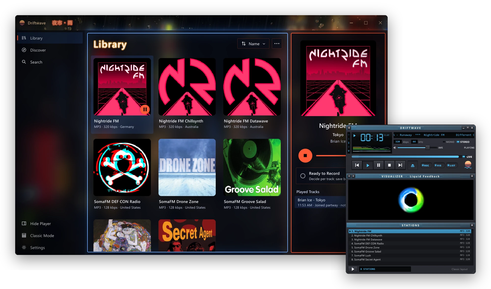

**Download:** the latest alpha is on [Releases](https://github.com/Joshspeakman/driftwave/releases). It's an alpha:
expect rough edges, and tell us about them.
- **Windows:** `Driftwave-<version>-win-x64.zip`. Unzip it, right-click `Install.ps1` and choose Run with PowerShell.
- **macOS 13 or later:** `Driftwave-<version>-mac-universal.zip`, for Apple silicon and Intel. Unzip it and drag
  `Driftwave.app` to Applications. It isn't notarized yet, so the first time, right-click it and choose Open (or
  allow it in System Settings > Privacy & Security). To build it yourself, see [A Mac app](#a-mac-app).

## One window, two looks

**Full:** your library, Discover and Search, station details, the player and the songs it has played, and Settings.
Right-click anywhere for a menu, and on a station for that station's own: play it, its details, add or remove it.

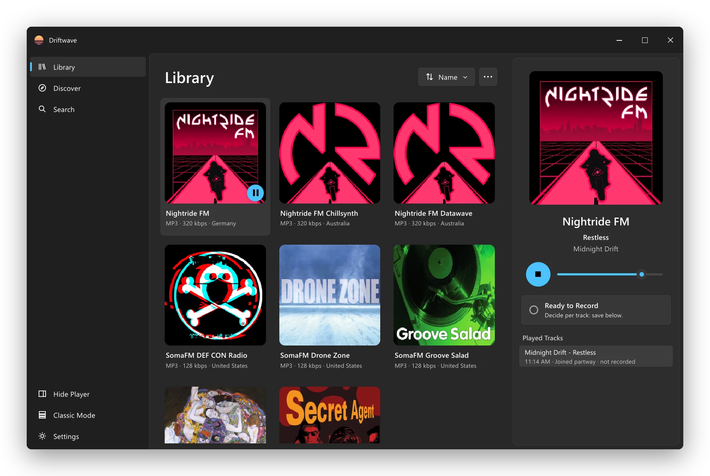

**Classic:** an LCD, a scrolling title, six original visualizers and a station list, stacked like the players of the
Winamp years. Right-click anywhere for its menu: text sizes, the visualizer, the theme, windowshade mode and the way
back to Full. It scales by dragging its corner, and the music carries on as you swap between the two.

| | | |
|---|---|---|
| 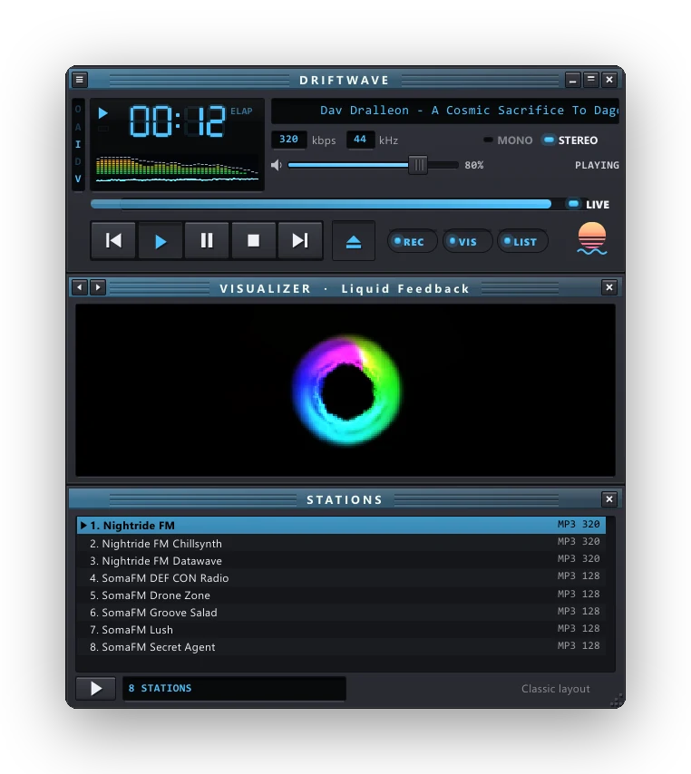 | 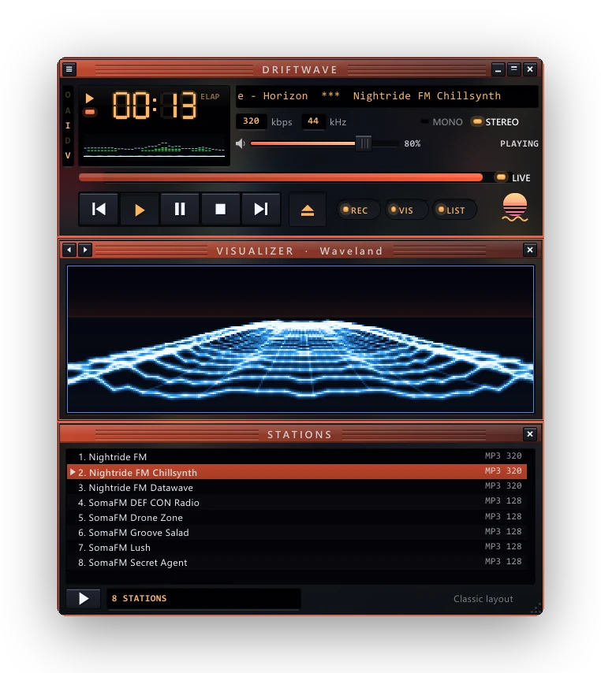 | 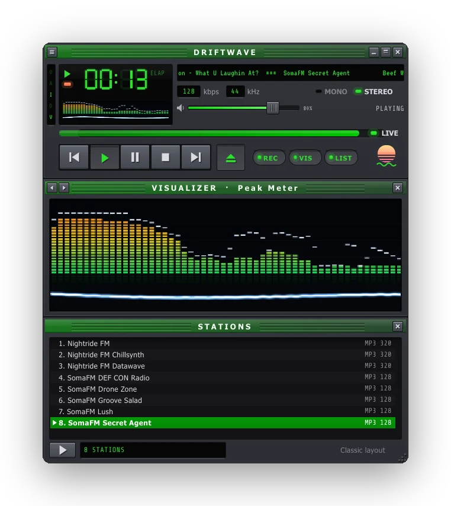 |

## Themes

Default (light, dark, or following your system) plus 26 built-in themes, every one in both layouts. Some are photo
scenes with rain running down the glass, neon, drifting light and moving street life; some are homages to the
desktops of their eras. Each looks the same in Classic as in Full: Classic's frames are made of the same glass,
walnut or metal. Make your own in the theme editor, or put your own picture or GIF behind the window. Nothing
ever flashes: moving scenes hold still on a slower computer or when Driftwave isn't in front.

| | |
|---|---|
| 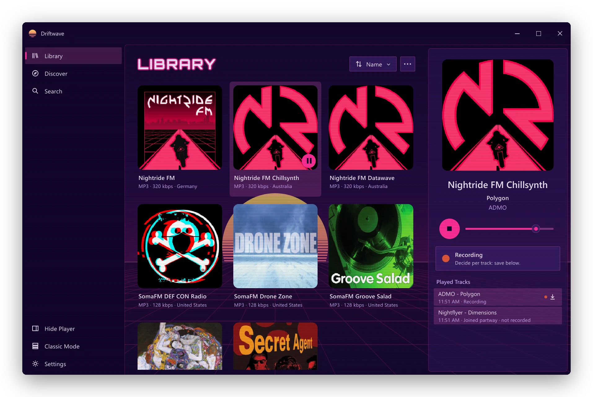 | 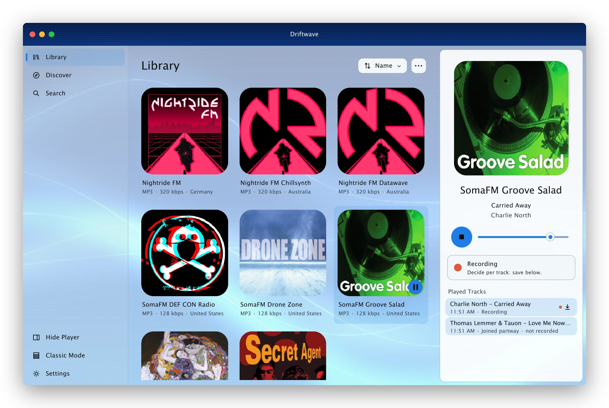 |
| 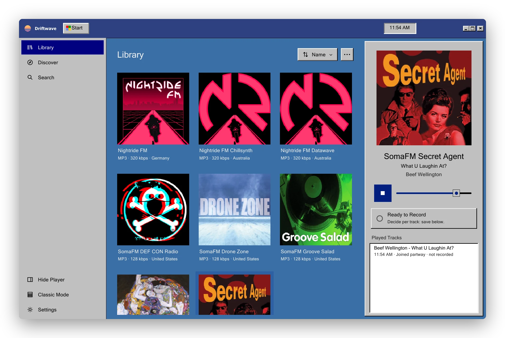 | 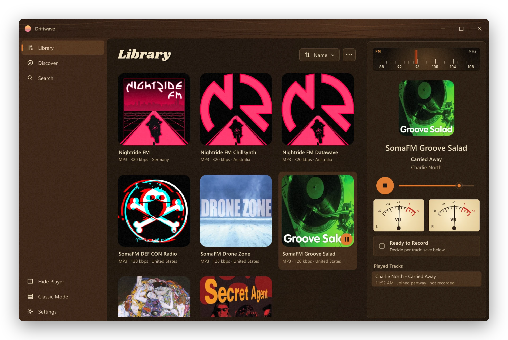 |
| 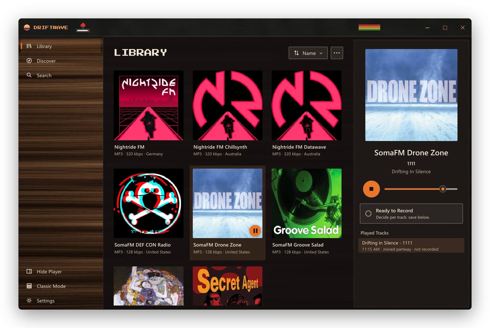 | 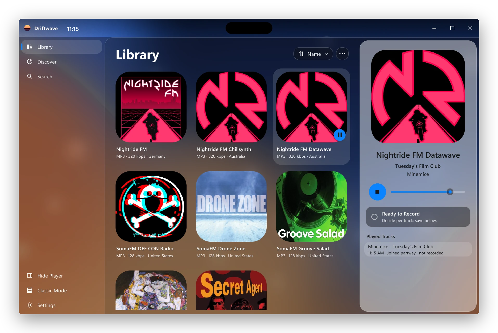 |

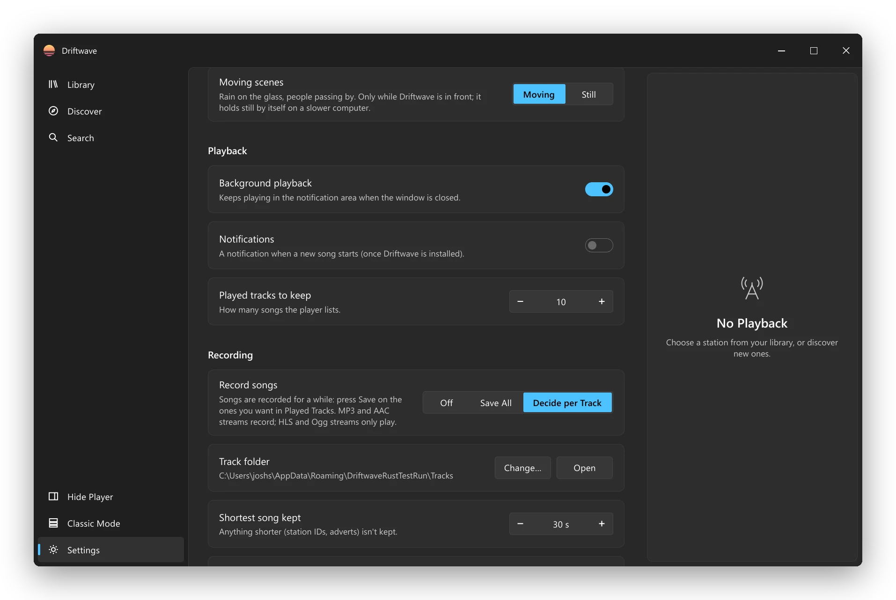

## Light by design

Driftwave is built in Rust around one idea: take as little of your computer as possible. It's one self-contained
program with nothing else to install, it downloads in a moment, and while it plays it barely registers.

| Measured on a Windows PC | |
|---|---|
| Download | 15.8 MB |
| Memory | about 46 MB while playing |
| CPU | under 1% of one core while playing (Default theme); a few percent with Classic's visualizer or a moving scene in front |

How it stays that small:
- **It draws only what changes,** in software, rather than starting up the graphics card for one window: in this
  window that measured about half the CPU and less than half the memory (40 MB against 100) of GPU drawing. Moving
  the visualizers to the graphics card was measured too: it would have cost 31 MB more and saved about 1% of a core.
- **Out of sight, out of the way:** behind other windows its scenes hold still; minimised or closed to the
  notification area, nothing draws at all, and only the radio plays.
- **It knows its limits:** visualizers draw within a fixed pixel budget that shrinks on a slower computer, and moving
  scenes hold still by themselves if they'd take more than their share.
- **No needless work:** recordings are copied byte for byte from the stream, never re-encoded.

## What it does

| Area | Driftwave |
|---|---|
| Library | Saved stations with covers, sorted by name, language, country, state, codec, votes or bitrate; import and export |
| Discover | Popular stations in your country, trending worldwide, random |
| Search | By name, filtered by country, language and tag; sorted by votes, clicks, name, bitrate or random |
| Station details | Tags, location, codec, bitrate, stream address, homepage |
| Your own stations | Add any stream; `.pls` and `.m3u` links are followed; choose a station's cover |
| Now playing | Song titles from the stream (ICY, HLS ID3 tags, Ogg comments), in time with what you hear |
| Recording | Save every song, decide for each one, or record nothing; shortest and longest lengths; your track folder. MP3 with its tags, AAC as a tagged `.m4a`, copied exactly, never re-encoded |
| Background playback | Keeps playing in the notification area or menu bar; a notification for each new song |
| Media controls | The system's media overlay and Now Playing, and the media keys |
| Updates | In-app updates from GitHub Releases |

Station data comes from the community database at [radio-browser.info](https://www.radio-browser.info).

## Credits and license

Driftwave is based on [Shortwave](https://gitlab.gnome.org/World/Shortwave) by Felix Häcker and contributors: its
design for finding, playing and recording internet radio, and parts of its recording model and wording. Like
Shortwave, Driftwave is free software: you can redistribute it and/or modify it under the terms of the
[GNU General Public License](LICENSE) as published by the Free Software Foundation, either version 3 of the License,
or (at your option) any later version. It is distributed in the hope that it will be useful, but WITHOUT ANY
WARRANTY; without even the implied warranty of MERCHANTABILITY or FITNESS FOR A PARTICULAR PURPOSE.

- The interface is made with [Slint](https://slint.dev).
- The theme fonts are under the SIL Open Font License (`assets/fonts`).
- Photographs used in themes are credited in `assets/theme-art/CREDITS.txt`; the other theme art is drawn by the
  scripts in `tools/`.
- Theme names that nod to classic desktops and players are homages; Driftwave isn't affiliated with any of them.
- The full list of fonts, photographs, libraries and services is in [THIRD-PARTY-NOTICES.md](THIRD-PARTY-NOTICES.md).

## Building

The workspace is `rust/`. Run cargo through `rust\cargo.ps1` on the PC, or plain `cargo` elsewhere.

```
cargo run --release -p driftwave-app          # the app (binary: driftwave)
cargo test --workspace                        # unit tests, including the visualizers' flash-safety test
cargo build --release -p driftwave-audio --bin driftwave-player   # the headless player for scripts/*
```

The playback tests drive the headless player against real streams and a local test server: `scripts/*.ps1` on
Windows, `scripts/*.sh` on the Mac. They need Python 3 and ffmpeg.

`scripts\launch-test.ps1` launches the app itself with the parts only a real launch otherwise starts (the
notification-area icon and the system media controls) and fails on a panic. Run it before packaging a release.

### A Windows release

`scripts\package-windows.ps1` builds the app and makes `dist\Driftwave-<version>-win-x64.zip` and its `.sha256`:
- the zip holds `Driftwave.exe` (with its icon and version, from the Windows SDK's `rc.exe`), the themes and their
  art, `Install.ps1`, `uninstall.ps1` and a README;
- `Install.ps1` installs for the current user (no admin rights) with a Start-menu shortcut carrying the app id
  `Joshspeakman.Driftwave` (which notifications need) and a Settings > Apps entry;
- published on a `v<version>` release of github.com/Joshspeakman/driftwave, the two files are what the in-app updater
  (Settings > Updates) finds, checks and installs. Versions follow semver: `1.0.0-alpha.1` < `1.0.0-alpha.2` <
  `1.0.0`.

The first launch of the installed app brings an earlier Driftwave's settings, themes and background across, and only
reads them.

### A Mac app

`scripts/package-mac.sh` builds `Driftwave.app` (Apple silicon or Intel, whichever Mac builds it) into
`~/ProjectBuilds/shortwave-macos/app`, ad-hoc signed, with its icon, bundle id `io.github.joshspeakman.Driftwave`
(which notifications need), the themes and their art. Drag it to Applications. `--nightly` builds
`Driftwave Nightly.app` alongside it, with its own bundle id. It needs Rust and the Xcode command line
tools.

The `Mac release` workflow (`.github/workflows/mac-release.yml`) does the same on a GitHub macOS runner from a
release tag, adds an Intel build to make it universal, and attaches `Driftwave-<version>-mac-universal.zip` and its
`.sha256` to that release.

## Layout of the repository

| Folder | What's in it |
|---|---|
| `rust/` | The app and its crates: `core`, `audio`, `vis`, `app`, `platform` |
| `themes/` | The built-in themes (JSON) |
| `assets/` | Theme art (photos credited in `theme-art/CREDITS.txt`), fonts (SIL OFL), icons |
| `tools/` | Generators for the themes, their art and the logo (Python) |
| `fixtures/` | Shared test files (station exchange, design libraries) |
| `scripts/` | Playback, launch and recording tests, their local ICY test server, and the Windows package |
| `docs/` | The scope and plan, design notes, the station exchange format, screenshots, and the Mac–PC sync log |
